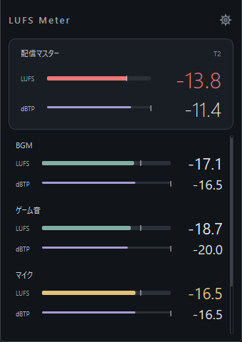
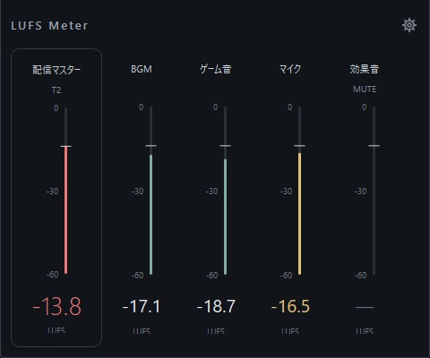

# LUFS Meter

OBSの音声ソースと配信マスターを表示する、コンパクトなLUFSメーターです。
Windows x64 / OBS Studio 32向け。別の音声プラグインは必要ありません。

**[最新版ZIPを直接ダウンロード](https://github.com/sayaka-aiart/LUFS-Meter/releases/latest/download/LUFS-Meter-Windows-x64.zip)** ·
[リリース一覧](https://github.com/sayaka-aiart/LUFS-Meter/releases) ·
[詳しい使い方](README_JA.md)

配布ZIPの中身は **obs-lufs-meter.dll** と **導入方法.txt** の2点です。

> 配信停止中のOBSミックスによる実測を確認しています。
> 配信サービスへの実接続や長時間稼働は、まだ検証していません。

| 横表示 | 縦表示 |
| --- | --- |
|  |  |

画像は検証用OBSでテスト音を計測した画面です。

## できること

- 配信トラックのマスターと、選んだ音声ソースを個別に計測。
- 瞬間 / 3秒平均 / 全体平均のLUFS表示。
- 目標値は既定 **−14 LUFS**。3 LU手前から黄色、目標を超えると赤。
- ソースごとの目標、表示選択、並べ替え、横・縦表示を右上の歯車で設定。
- libebur128を内蔵。音声を変更しない計測専用プラグイン。

## インストール

1. 上のボタンから **LUFS-Meter-Windows-x64.zip** をダウンロードして展開します。
2. OBSを終了し、展開した **obs-lufs-meter.dll** を、
   OBSインストール先の **obs-plugins/64bit/** へコピーします。
3. OBSを起動し、**ドック → LUFS Meter** を開きます。

通常インストールのコピー先は C:/Program Files/obs-studio/obs-plugins/64bit/ です。
QtやOBS本体のDLLを追加コピーする必要はありません。
削除するときはOBSを終了して、このプラグインのDLLだけを取り除きます。

GitHubが自動生成する「Source code」のZIPは開発用です。
インストールには **LUFS-Meter-Windows-x64.zip** を選んでください。

## 計測の範囲

マスターは配信先に選ばれたOBS音声トラックの、エンコード前の合成音を測ります。
ソース別はフィルター後の音声と現在のOBS音量を使います。
ソースのLUFSを足し算してマスターを作る処理はありません。
対応はモノラル / ステレオです。

[測定仕様・制限](README_JA.md#測定範囲) · [検証記録](docs/VERIFICATION.md)

## 開発

[Windowsでビルド](docs/BUILDING.md) · [リリース方法](docs/RELEASING.md) · [変更履歴](CHANGELOG.md)

計測部分だけならQt/OBSなしでテストできます。

    cmake -S . -B build-core -DBUILD_OBS_PLUGIN=OFF
    cmake --build build-core --config Release
    ctest --test-dir build-core -C Release --output-on-failure

## ライセンス

独自コードは **GPL-2.0-or-later**。libebur128はMIT、
同梱のqueue.hはBSD-3-Clauseです。
ライセンス全文と著作権表示はDLL内にも収録しています。
対応ソースとライセンスは[別ZIPでダウンロード](https://github.com/sayaka-aiart/LUFS-Meter/releases/latest/download/LUFS-Meter-Source-and-Licenses.zip)できます。

[LICENSE](LICENSE) · [Third-party notices](THIRD_PARTY_NOTICES.md)
