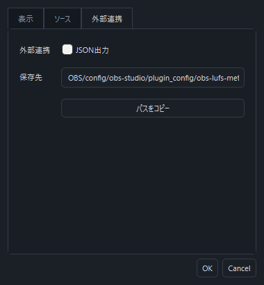

# Codex・外部ツールとの連携

## 数値を読み出す

1. LUFS Meterの歯車 → **外部連携** → **JSON出力** をオンにします。
2. **パスをコピー** でreadings.jsonの保存先を取得します。
3. [ソース・ライセンスZIP](https://github.com/sayaka-aiart/LUFS-Meter/releases/latest/download/LUFS-Meter-Source-and-Licenses.zip)を展開すると、scripts/に連携スクリプトがあります。

保存先はOBSの環境によって異なります。通常インストールの出力先は次の場所です。

    %APPDATA%/obs-studio/plugin_config/obs-lufs-meter/readings.json

ポータブル版はそのOBSのconfig内へ出力します。複数のOBSを使う場合も、
対象のOBSからコピーしたパスを --file で指定してください。

Python 3.10以降の標準ライブラリだけで読み取れます。

    python scripts/read_meter.py
    python scripts/read_meter.py --source "マイク"
    python scripts/read_meter.py --master
    python scripts/read_meter.py --samples 20 --interval 0.5
    python scripts/read_meter.py --file "コピーしたパス" --source "ソースUUID"

複数サンプルは1行1JSONのNDJSON形式です。--watchはCtrl+Cまで継続します。
ソース名が重複している場合はUUIDを指定します。

出力は500msごとにファイル全体を置換します。書き込み途中のJSONを
読み込ませないよう、一時ファイルからの置換に成功した場合だけ公開します。
ネットワークサーバーを起動せず、音声データも書き出しません。
JSON出力の初期値はオフです。表示対象に選んだソースと配信マスターを出力します。
画面のLUFS / True Peak表示のオン・オフに関係なく、全測定モードの数値を出力します。

## JSONに含まれる情報

| 項目 | 内容 |
| --- | --- |
| schemaVersion / pluginVersion | JSON形式とプラグインのバージョン |
| instanceId / obsPid / sequence | OBS起動単位の識別子、プロセスID、更新番号 |
| updatedAtUnixMs / updatedAtUtc | 出力時刻 |
| status / exportEnabled | 実行・停止・無効・音声準備中などの状態 |
| profile / collection | 対象のOBSプロファイルとシーンコレクション |
| sampleRateHz / channels | 音声形式 |
| configuredTrackMask / effectiveTrackMask | 設定上と実測対象の配信トラック |
| masters / sources | マスター・ソースごとの測定値 |

各行にはid、name、lufs.momentary / shortTerm / integrated、
truePeakDbtp、truePeakMaxDbtp、目標LUFS、ゲイン、ミュート、
配信トラックへの送信状態、測定フレーム数、リセット回数、欠落回数を含みます。

測定前・ミュート・音声停止・無音などの非数値はJSONのnullです。
NaNやInfinityを数値として出力しません。MAXはミュート後も保持されます。
現在値を判断するときは、行のstatus・fresh・lufsReady・truePeakAvailableと、
実際に数値が入っていることを確認してください。

read_meter.pyは、既定で2秒を超えた出力、未来にずれた時刻、停止・無効状態を
エラーにします。OBS終了時はstatusがstopped、出力オフではdisabledになります。
強制終了した場合は更新時刻の期限切れで検出します。
--allow-staleは履歴調査用で、reader.freshがfalseになります。

## OBSの設定を取得・変更する

操作用の [obs_control.ps1](../scripts/obs_control.ps1) はPowerShell 7以降と
OBS WebSocket 5を使用します。追加のPythonパッケージやMCPサーバーは不要です。
OBSの **ツール → WebSocketサーバー設定** でサーバーと認証を有効にします。
接続先の初期値は ws://127.0.0.1:4455 です。ローカル接続に対応します。

認証パスワードは、このPowerShellセッションのOBS_WEBSOCKET_PASSWORD環境変数で渡します。
次の入力例はPowerShell 7.1以降で使用できます。

    $env:OBS_WEBSOCKET_PASSWORD = Read-Host 'OBS WebSocketのパスワード' -MaskInput

まず入力一覧と、対象の現在の音量・フィルターを取得します。

    ./scripts/obs_control.ps1 -Action Inspect
    ./scripts/obs_control.ps1 -Action Inspect -Source "マイク"

Sourceは正確なソース名かUUIDです。安定した指定にはJSONのidを使用してください。

設定変更には **-Apply** と、新しい **-BackupPath** を指定します。
変更前の状態を書き込んでからOBSに変更を送り、結果を読み直して確認します。
既存のバックアップは上書きしません。

    ./scripts/obs_control.ps1 -Action SetVolume -Source "マイク" -VolumeDb -9 -Apply -BackupPath "./backups/mic-volume-before.json"

VolumeDbはOBS入力フェーダーのdB値です。LUFSの目標値とは別です。
指定範囲は−60～＋6 dBです。

既存フィルターを変更する例です。対象フィルターの現在の設定はInspectで確認できます。

    ./scripts/obs_control.ps1 -Action SetFilter -Source "マイク" -FilterName "ゲイン" -SettingsJson '{"db":-3}' -Apply -BackupPath "./backups/mic-filter-before.json"

新しくゲインフィルターを追加する例です。

    ./scripts/obs_control.ps1 -Action CreateFilter -Source "マイク" -FilterName "調整用ゲイン" -FilterKind gain_filter -SettingsJson '{"db":0}' -Apply -BackupPath "./backups/mic-filter-created.json"

フィルターが公開している数値・文字列・真偽値の設定に対応します。
公開されていないVST独自画面の操作などは対象外です。

変更前へ戻すときも、復帰直前の状態を新しいファイルへ保存します。
プロファイル・コレクション・ソースUUID・フィルター種類の一致を確認して復帰します。
CreateFilterのバックアップから復帰すると、その追加したフィルターを取り除きます。

    ./scripts/obs_control.ps1 -Action Restore -FromBackup "./backups/mic-filter-before.json" -Apply -BackupPath "./backups/mic-filter-restore-before.json"

設定変更後、履歴を混ぜずに再計測する場合は次を実行します。
LUFSの全体平均とTrue PeakのMAXもリセットされます。

    ./scripts/obs_control.ps1 -Action ResetMeters -Apply

リセット後は瞬間LUFSに約0.4秒、3秒平均に約3秒の音声が必要です。
設定変更の効果を比べる際は、同じ音声や同じ話し方で再計測してください。

OBS操作は [OBS WebSocketの公式プロトコル](https://github.com/obsproject/obs-websocket/blob/master/docs/generated/protocol.md)を使います。
LUFS Meter自身が勝手に音量やフィルターを変更する機能はありません。
Codexなどから操作スクリプトを呼び出すときに、指定した操作を実行します。

## Codexから使うとき

このフォルダーと、外部連携画面でコピーしたJSONパスをCodexに伝えます。
「マイクを10秒計測し、現在の音量・フィルター設定と合わせて確認して」
という読み取りから始められます。調整を依頼すれば、バックアップ・設定変更・
リセット・再計測・必要に応じた復帰をスクリプト経由で実行できます。

検証用OBSでは、JSON更新・認証接続・音量変更による約−6 dBの変化、
ゲインフィルターによる−3 dBの変化、設定復元、計測リセット、
OBS終了後の読み取り拒否を確認しています。
